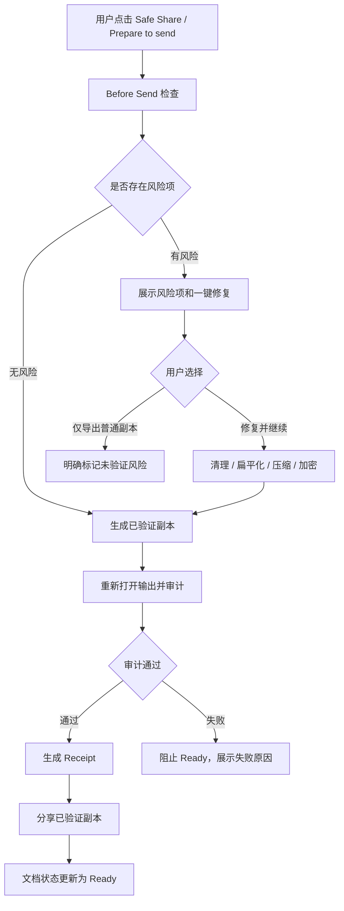
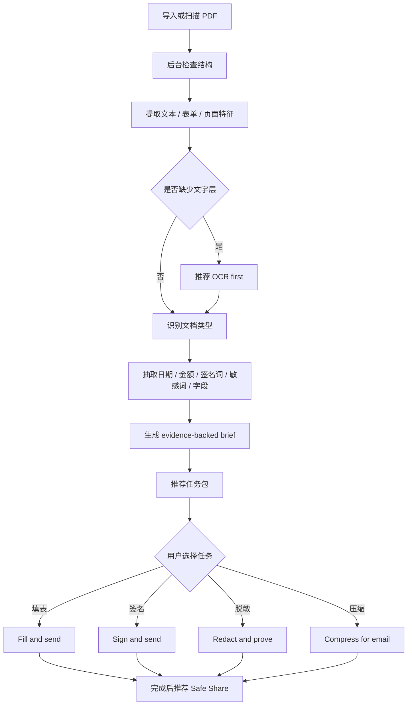

# PaperPath 核心方向与 10 轮迭代规划

更新时间：2026-08-14

## 0. 产品结论

PaperPath 不应该被定义成“小号 Acrobat”。这个方向不成立，也不经济。Acrobat、PDF Expert、Xodo 这类成熟工具的全量能力太宽：Office 转换、复杂编辑、云协作、企业签名、跨端同步都不是 PaperPath 这种小而美产品应该硬拼的主战场。

PaperPath 更合理的定义是：

> 本地 PDF 完成与安全交付工作台。

它解决的不是“所有 PDF 功能都最多”，而是用户最常见、最高压的一个问题：

> 这份 PDF 我能不能放心发出去？它签了吗、填了吗、压缩了吗、脱敏了吗、有没有泄露元数据、对方能不能打开？

这就是 PaperPath 的存在理由。竞品多数给用户一堆工具，PaperPath 应该给用户一条完成路径。

## 1. 现有能力基线

### 1.1 当前 Quick Task

当前首层任务已有 14 个：

| 分组 | 已有功能 |
|---|---|
| Create | Scan to PDF, Images to PDF |
| Pages | Merge PDFs, Split PDF, Organize Pages |
| Edit & Secure | Compress PDF, Fill Forms, Sign PDF, Redact PDF, Protect PDF, Safe Share |
| Convert | OCR PDF, PDF to Office, PDF to Images |

### 1.2 当前工作区工具

工作区内部已有 18 个工具：

| 分组 | 已有功能 |
|---|---|
| Understand | Brief, Find, Recognize |
| Mark Up | Highlight, Underline, Strike, Draw, Note, Stamp, Annotations |
| Finish | Sign, Redact, Fill Form, Protect |
| Pages | Bookmarks, Organize |
| Export | Compress, Export |

### 1.3 已经不是“系统控件套壳”的部分

| 能力 | 当前价值 |
|---|---|
| 本地文档理解 | 检查页数、文字覆盖、表单、保护状态，并生成 evidence-backed brief |
| OCR 与可搜索副本 | Vision OCR 后写入可搜索 PDF，不只是展示识别结果 |
| 安全输出 | 扁平化、压缩、脱敏、清元数据、加密、导出 |
| 输出审计 | 重新打开输出文件，检查页数、空白页、注释、文字层、元数据、加密状态 |
| 工作副本 | 源文件不改，所有处理都在 App 沙盒副本完成 |

### 1.4 仍不够极致的地方

| 问题 | 影响 | 处理策略 |
|---|---|---|
| 功能入口仍偏“工具列表” | 用户要自己判断该用哪个工具 | 改成任务包和下一步推荐 |
| 安全交付证明还不够前台化 | 技术上做了，但用户感知不足 | 做成 Before Send / Receipt 核心体验 |
| 文档理解偏规则型 | 能用，但不够聪明 | 加强类型识别、实体抽取、证据页、置信度 |
| 批量和配方能力不足 | 高频用户效率不够 | 引入批量安全交付和保存的处理配方 |
| 压缩/脱敏依赖重渲染 | 安全但可能损失质量 | 提供质量预览、输出等级和明确说明 |

## 2. 同类工具对比

主对标不再是 Acrobat 全量套件，而是更接近的轻量 PDF 工具和移动 PDF 工具。

| 场景 | PDFgear | Xodo | PDF Expert | Smallpdf / iLovePDF | PaperPath 应该赢在哪里 |
|---|---|---|---|---|---|
| 快速处理 PDF | 功能多，免费感强 | 工具覆盖广 | iOS 体验强 | Web 工具路径短 | 本地、不上传、按任务直接进入 |
| 阅读与批注 | 可用 | 强 | 很强 | 弱 | 不硬拼长阅读，聚焦完成任务 |
| 签名填表 | 有 | 有 | 很成熟 | 部分支持 | 做成“签完并发出”的闭环 |
| 压缩与转换 | 有 | 有 | 有 | 很强 | 做“为邮件/微信/报销压缩”的目标化入口 |
| 脱敏与安全分享 | 有但偏工具 | 有 | 有 | 多依赖上传 | 输出前检查 + receipt + 源文件不改 |
| OCR | 有 | 有 | 有 | 多为云端或会员 | 本地 OCR + 可搜索副本 + 证据页 |
| 批量处理 | 一般 | 较强 | 一般 | Web 批量强 | 本地批量 Safe Share 和处理配方 |
| 信任感 | 取决于品牌 | 工具型 | 品质强 | 上传焦虑明显 | 无账号、无上传、每次输出有证明 |

判断：

- PaperPath 不需要在“功能数量”上超过所有同类。
- PaperPath 必须在“用户从拿到 PDF 到放心发出去”的路径上明显更短。
- PaperPath 的核心卖点不是“我也能做压缩/签名/脱敏”，而是“我知道你现在该做什么，并能证明已经做完”。

## 3. PaperPath 与 Acrobat：安全交付场景差异

这里 Acrobat 只作为安全交付的专业参考，不作为产品总量目标。

| 维度 | Acrobat | PaperPath 目标 | PaperPath 是否应硬拼 |
|---|---|---|---|
| 专业功能总量 | 企业级，能力极宽 | 小而精，围绕发出前完成 | 不硬拼 |
| 数字证书签名 | 强 | 暂不做证书签名 | 不硬拼 |
| PDF 原文编辑 | 强 | 不做复杂原文编辑 | 不硬拼 |
| 红线脱敏 | 成熟 | 做本地永久脱敏和验证证明 | 要做到更直达 |
| 元数据清理 | 有 | 明确展示清理结果 | 要做到更可感知 |
| 扁平化输出 | 有 | 一键生成不可编辑分享副本 | 要做到更短路径 |
| 输出可打开验证 | 用户通常自己判断 | 自动重开并审计输出 | PaperPath 差异点 |
| 源文件保护 | 用户需理解原/副本关系 | 默认工作副本，源文件不改 | PaperPath 差异点 |
| 隐私路径 | Acrobat 生态和账号更重 | 无账号、无上传、本地处理 | PaperPath 差异点 |
| 用户心智 | 专业工具箱 | 发出前检查员 | PaperPath 差异点 |

安全交付场景下，PaperPath 的胜负手不是“比 Acrobat 更专业”，而是：

> 更短路径 + 更少判断 + 更清楚的交付证明。

## 4. 10 轮迭代总路线

| 轮次 | 主题 | 核心产出 | 成功标准 |
|---|---|---|---|
| R1 | 任务直达与功能重组 | 首页任务包、文档卡下一步、无文档也能先选任务 | 高频任务 2 步内进入 |
| R2 | 交付可信引擎 v1 | Before Send 检查、修复项、Receipt、输出历史 | 每个分享副本都有可解释证明 |
| R3 | 文档任务理解 v1 | 类型识别、实体抽取、证据页、任务包推荐 | 导入后首推任务命中率达到可验收标准 |
| R4 | 一键修复链路 | “修复并继续”把压缩、清理、扁平化、加密串起来 | 用户不需要手动找第二个工具 |
| R5 | 脱敏与隐私证明 | 敏感内容扫描、红线预览、脱敏后验证 | 脱敏不是涂黑，而是可验证删除 |
| R6 | 批量与处理配方 | 批量压缩、批量 Safe Share、保存常用配方 | 多文件场景效率超过 Web 小工具 |
| R7 | 扫描与 OCR 质量 | OCR 置信度、低质量页提示、重新扫描建议 | 扫描件从“能识别”变成“可交付” |
| R8 | 表单与签名闭环 | 未填字段、签名位、完成状态、签后推荐 Safe Share | 表单/合同路径更像助理而不是工具 |
| R9 | 分享与归档体验 | 输出命名、目标大小、最近收件场景、归档状态 | 用户清楚哪份是最终版 |
| R10 | 商业发布收敛 | 真实样本验收、同类工具对标、性能/无障碍/边界清单 | 可以写出可信发布说明 |

## 5. 前 3 个迭代详细规划

### R1：任务直达与功能重组

目标：把 PaperPath 从“PDF 工具列表”改成“我现在要完成什么”。

#### 功能清单

| 模块 | 功能 | 说明 |
|---|---|---|
| 首页任务包 | Prepare to send | 包含签名、填表、压缩、清理、Safe Share |
| 首页任务包 | Make searchable | 扫描件直接进入 OCR + 可搜索副本 |
| 首页任务包 | Compress for email | 目标导向压缩，而不是单纯 Compress |
| 首页任务包 | Redact and prove | 脱敏后自动进入验证 |
| 首页任务包 | Pages quick fix | 合并、拆分、旋转、裁切、插入空白页 |
| 文档卡 | 下一步主按钮 | 根据文档类型显示 Fill, Sign, OCR, Safe Share |
| 搜索 | 意图搜索 | 输入“发出去”“太大”“签字”“去掉隐私”能找到任务 |
| 空库 | 先选任务再导入 | 用户可先点任务，之后再选择文件 |
| 工具面板 | 隐藏不适用工具 | 单页不优先出现 Organize；锁定文档不展示不支持工具 |

#### 验收标准

| 验收项 | 标准 |
|---|---|
| 路径长度 | 新用户从打开 App 到进入高频任务不超过 2 次点击 |
| 任务命中 | 8 个常见意图：签字、压缩、合并、拆分、OCR、填表、脱敏、发出前检查，都能在首页或搜索直接到达 |
| 无死按钮 | 首页所有入口都能完成真实动作，不能出现空壳入口 |
| 文案 | 不出现“强大、智能、革命性”等空泛词，只说用户能完成的事 |
| 空库 | 没有文档时仍能先选择任务，随后进入导入/扫描 |
| 不适用状态 | 对锁定、单页、无文字层文档，工具推荐不误导 |

### R2：交付可信引擎 v1

目标：让 PaperPath 在“发出前检查和证明”上形成可感知优势。

#### 功能清单

| 模块 | 功能 | 说明 |
|---|---|---|
| Before Send | 交付检查面板 | 显示页数、大小、注释、元数据、文字层、密码、空白页 |
| Risk Items | 风险项解释 | 例如“仍有 3 个可编辑批注”“包含作者元数据” |
| One-tap Fix | 一键修复 | 清元数据、扁平化、重渲染、压缩、加密 |
| Verified Copy | 已验证副本 | 输出后重新打开检查，不通过则不标记 Ready |
| Receipt | 交付证明 | SHA-256、生成时间、源文件名、输出大小、检查项 |
| History | 输出历史 | 文档内保留最近交付副本记录 |
| Share Gate | 只分享通过副本 | 分享入口优先指向已验证副本 |

#### 验收标准

| 验收项 | 标准 |
|---|---|
| 源文件安全 | Safe Share 不修改原始导入文件 |
| 输出验证 | 输出 PDF 必须能重新打开，页数必须匹配预期 |
| 元数据 | Safe Share / Redact / Flatten 输出默认清理个人元数据 |
| 批注 | Flatten / Safe Share 输出不得保留可编辑批注 |
| Receipt | 每个已验证输出都持久化 receipt，并可从文档页重新查看 |
| 失败处理 | 输出失败时给出具体原因，不允许静默失败或继续分享 |
| 用户理解 | 用户能在 5 秒内看懂“能不能发”和“为什么” |

### R3：文档任务理解 v1

目标：让导入后的第一屏能告诉用户“这是什么文件、该做什么、依据在哪里”。

#### 功能清单

| 模块 | 功能 | 说明 |
|---|---|---|
| 类型识别 | Contract / Form / Scan / Invoice / Report / Mixed | 从文字、字段、页面结构综合判断 |
| 实体抽取 | 日期、金额、邮箱、电话、账号样式、签名词 | 用于任务推荐和风险提示 |
| 证据页 | 点击原因跳转原文页 | 所有推荐必须能解释来源 |
| 任务包推荐 | Fill and send, Sign and send, OCR first, Redact and prove | 推荐的是完成路径，不是单个工具 |
| 置信度 | High / Medium / Low | 低置信度时不装聪明，只展示“可能需要” |
| 例外状态 | 锁定、损坏、无文字、超大文件 | 给出可操作路径 |

#### 验收标准

| 验收项 | 标准 |
|---|---|
| 推荐准确性 | 内部样本文档中，Top 1 推荐命中主要任务目标不低于 80% |
| 证据可追溯 | 每条关键推荐至少能跳到一个证据页或字段 |
| 不误导 | 低置信度推荐必须使用“可能需要”，不能给确定性结论 |
| 任务闭环 | 完成推荐任务后，文档状态推进并更新下一步 |
| 性能 | 文档理解不得阻塞主线程，大文件采用采样和后台处理 |
| 隐私 | 分析过程本地完成，不上传文档和提取文本 |

## 6. 交付可信引擎：用户交互流程图

关键交互原则：

- Safe Share 不是一个普通导出按钮，而是发出前检查。
- 用户先看到“能不能发”，再看到“为什么”。
- 所有修复动作都生成新副本，不破坏源文件。
- 失败时不允许继续伪装成功。

## 7. 文档任务理解：用户交互流程图

关键交互原则：

- 推荐必须有 WHY，不要让用户猜。
- 推荐的是“完成路径”，不是孤立工具。
- 低置信度时保守表达，不制造错误确定性。
- 每次完成任务都应更新状态，避免反复推荐同一件事。

## 8. 功能更全，但不变重的方向

新增功能不应按“大厂全家桶”扩张，而应按“任务包”扩张。

| 用户说法 | 对应任务包 | 可能包含的底层工具 |
|---|---|---|
| 我要发给别人 | Prepare to send | Safe Share, Flatten, Clean metadata, Receipt |
| 文件太大了 | Compress for email | Compress, output target, share preview |
| 这份要签字 | Sign and send | Find signature page, Sign, Flatten, Safe Share |
| 这是扫描件 | Make searchable | OCR, confidence, searchable copy, Find |
| 我要去掉隐私 | Redact and prove | Detect sensitive text, Redact, Audit, Receipt |
| 我要报销/提交 | Fill and submit | Form fields, signature, flatten, verified copy |
| 只要几页 | Extract packet | Select pages, rename output, receipt |
| 几份合成一份 | Assemble packet | Merge, reorder, blank pages, final check |
| 要长期保存 | Archive clean copy | Flatten, metadata clean, bookmarks, receipt |
| 我要批量处理 | Batch safe share | Multi-select, recipe, output folder |

这样功能会更全，但用户感受到的是“我想干什么”，不是“又多了 20 个按钮”。

## 9. 判断产品是否值得做的最终标准

PaperPath 值得做的前提是能稳定回答下面 5 个问题：

1. 这份 PDF 现在是什么状态？
2. 用户下一步最可能要做什么？
3. 做完后能不能放心发？
4. 如果不能发，为什么，怎么一键修？
5. 发出去的是不是一个可验证的新副本？

如果这 5 个问题 PaperPath 比同类轻量工具回答得更快、更稳、更清楚，它就有存在价值。

## 10. 北极星指标

| 指标 | 目标 |
|---|---|
| Time to first correct action | 导入后 5 秒内出现正确下一步 |
| Time to verified share | 高频文档 60 秒内生成可分享验证副本 |
| Source safety | 100% 操作不破坏源文件 |
| Local privacy | 核心处理 0 上传、0 账号依赖 |
| Recommendation trust | 每条推荐都有证据或明确置信度 |
| Dead-end rate | 高频入口 0 空壳、0 不可完成 |
| Repeat work | 完成动作后不再重复推荐同一任务 |
